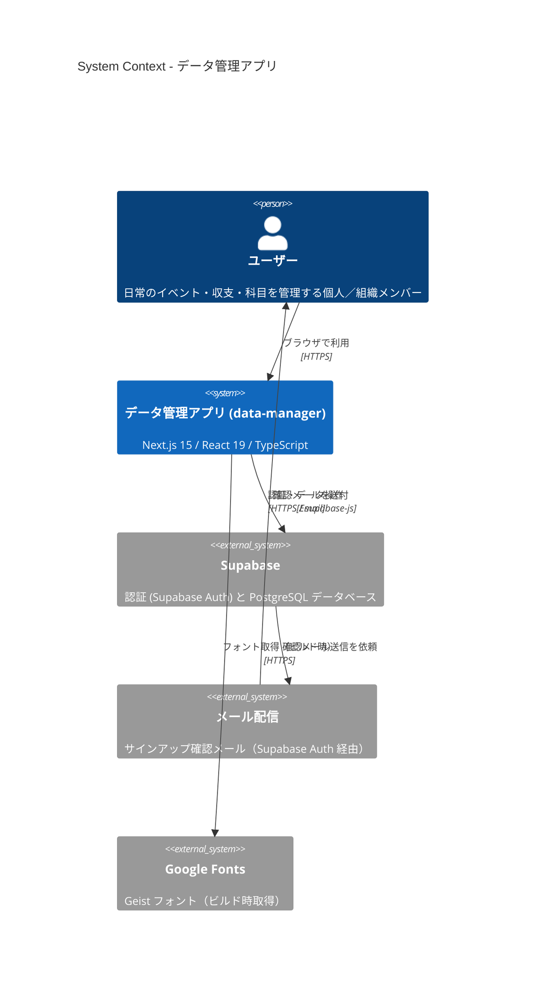

# data-manager

日常生活のデータ（イベント・家計簿/仕訳・科目・組織/グループ）を統合管理する Web アプリケーションです。

## アーキテクチャ概要

Next.js（`web/`）のクライアントから Supabase（Auth + PostgreSQL）へ直接アクセスする構成です。詳細（Container / Component 図、データフロー、ディレクトリ構成）は [docs/architecture.md](docs/architecture.md) を参照してください。

---

## リポジトリ構成

- `web/` — Next.js アプリ本体（セットアップ手順は [web/README.md](web/README.md)）
- `server/` — DB 設計（`create_tables.sql`, ER 図）
- `docs/` — 設計ドキュメント
