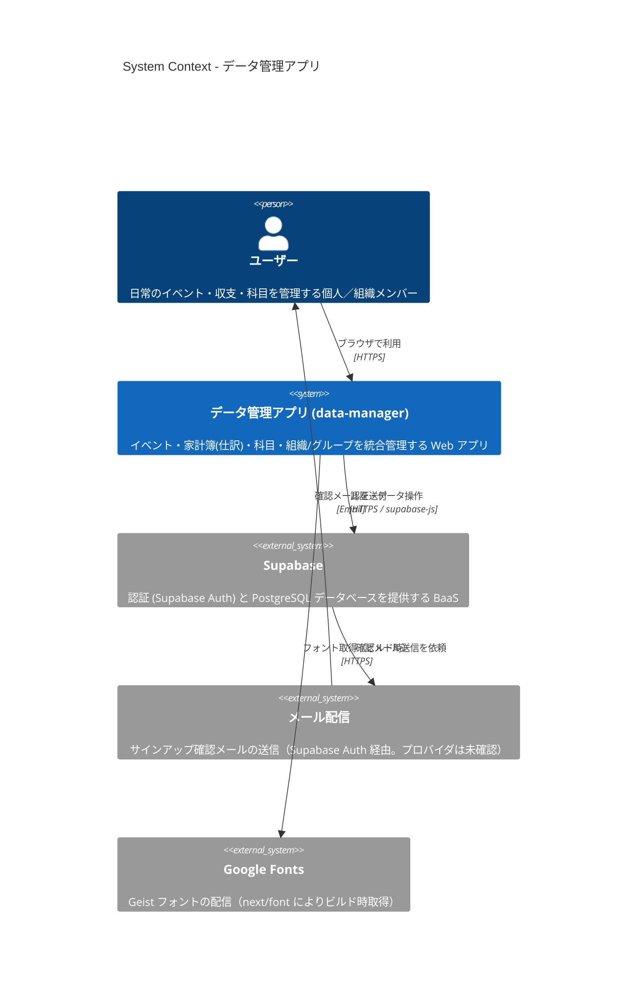
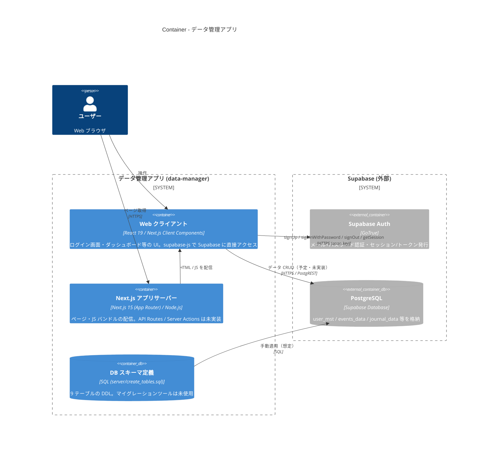
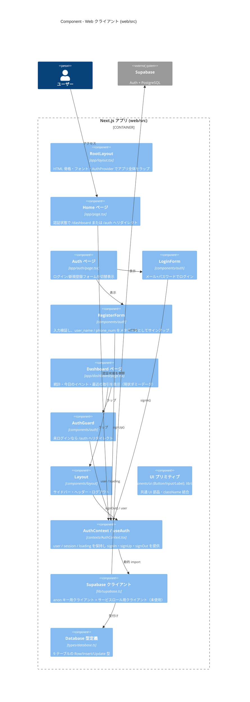
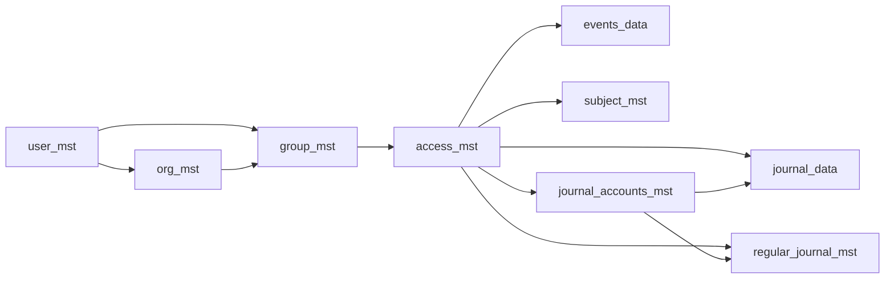
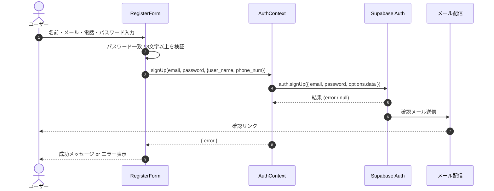
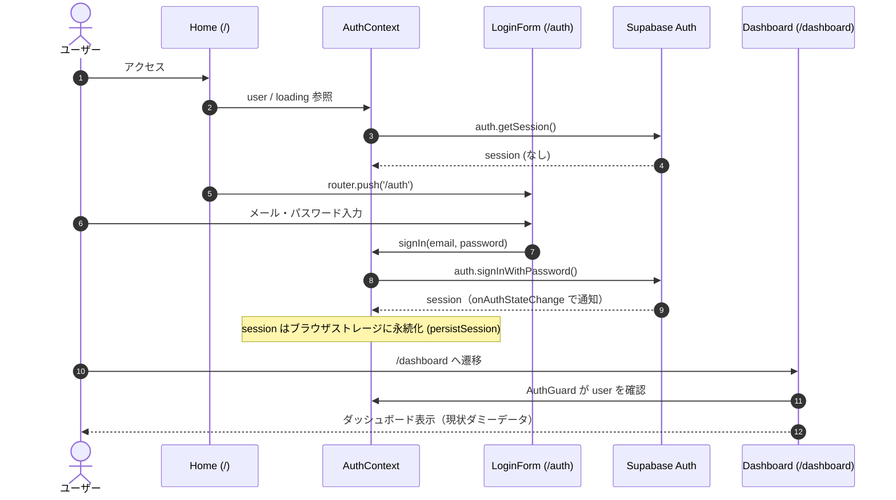

# アーキテクチャ（C4モデル）

本ドキュメントは、リポジトリ内のコード・設定ファイルを根拠に `data-manager` のアーキテクチャを C4 モデル（Context / Container / Component）で整理したものです。
コードから確認できない事項は **「未確認」** と明記しています。

> 調査時点のコミット: `43e5c47`（メイン画面UIの大枠完成）

---

## 1. 概要

### 目的

日常生活のデータ（コト＝イベント／予定、カネ＝家計簿・仕訳、モノ＝科目）を統合管理する Web アプリケーション。
根拠: `web/src/app/layout.tsx` の `metadata`（`title: "データ管理アプリ"`, `description: "日常生活のデータを統合管理するアプリケーション"`）、`server/entity-relationship-diagram.md` のコメント。

### 主な利用者

| 利用者 | 説明 | 根拠 |
|---|---|---|
| 一般ユーザー（個人） | メールアドレス＋パスワードでアカウント登録・ログインし、自分のイベント／収支を管理する | `LoginForm.tsx`, `RegisterForm.tsx` |
| 組織・グループのメンバー | 組織（`org_mst`）・グループ（`group_mst`）単位でデータを共有する想定 | ER図・`create_tables.sql`。**UI・アクセス制御ロジックは未実装** |

### 現在の実装状況（重要）

- 実装済み: サインアップ／ログイン／ログアウト（Supabase Auth）、認証ガード、ダッシュボード画面の UI。
- ダッシュボードの数値・イベント・取引は **コード内のハードコードされたダミーデータ** で、DB からの取得はまだ行っていない（`web/src/app/dashboard/page.tsx`）。
- サイドバーのリンク先 `/events` `/journal` `/subjects` `/organizations` `/settings` に対応するページは **未作成**。
- `supabaseServiceRole`（サービスロールキーを使うクライアント）は `web/src/lib/supabase.ts` に定義されているが、**どこからも使用されていない**。
- DB テーブルは `server/create_tables.sql` で定義済みだが、アプリからのクエリ（`.from(...)`）は未実装。RLS ポリシー・`auth.users` と `user_mst` の同期トリガーは SQL 内に **定義なし**。

### 技術スタック

| 分類 | 技術 | バージョン / 備考 | 根拠 |
|---|---|---|---|
| 言語 | TypeScript | ^5 | `web/package.json`, `tsconfig.json` |
| フロントエンド FW | Next.js（App Router） | 15.5.3（`--turbopack` で dev/build） | `web/package.json` |
| UI ライブラリ | React | 19.1.0 | `web/package.json` |
| スタイリング | Tailwind CSS v4（`@tailwindcss/postcss`）, `clsx`, `tailwind-merge` | — | `postcss.config.mjs`, `lib/utils.ts` |
| アイコン | lucide-react | ^0.544.0 | `Layout.tsx`, `dashboard/page.tsx` |
| BaaS / 認証 | Supabase（`@supabase/supabase-js`） | ^2.58.0 | `lib/supabase.ts`, `contexts/AuthContext.tsx` |
| DB | PostgreSQL（Supabase 上を想定） | — | `server/create_tables.sql`（`UUID`, `BYTEA`, `TIMESTAMP` 等の PostgreSQL 型） |
| フォント | Geist / Geist Mono（`next/font/google`） | ビルド時に Google Fonts から取得 | `app/layout.tsx` |
| Lint | ESLint 9 + `eslint-config-next` | — | `eslint.config.mjs` |
| 依存定義のみ（コード未使用） | Radix UI 各種, `@supabase/auth-ui-react`, `recharts`, `date-fns` | 今後の利用を想定と推測 | `web/package.json`（`src` 内で import なし） |
| ホスティング | **未確認**（Vercel 用設定・Dockerfile・IaC なし） | — | — |
| CI/CD | **なし**（`.github/workflows` なし） | — | — |

---

## 2. Level 1: System Context 図



| 名前 | 種別 | 技術 | 責務 |
|---|---|---|---|
| ユーザー | Person | Web ブラウザ | アカウント登録・ログインし、イベント／収支などのデータを閲覧・登録する |
| データ管理アプリ | Software System（本システム） | Next.js / React / TypeScript | 日常データの統合管理 UI を提供する |
| Supabase | External System | Supabase Auth, PostgreSQL | ユーザー認証（メール＋パスワード）、セッション管理、データ永続化 |
| メール配信 | External System | 未確認（Supabase 標準 SMTP か独自 SMTP かは設定ファイルなし） | サインアップ時の確認メール送信（`RegisterForm.tsx` のメッセージより） |
| Google Fonts | External System | `next/font/google` | Geist フォントの取得（ビルド時にセルフホスト化） |

---

## 3. Level 2: Container 図



| 名前 | 種別 | 技術 | 責務 |
|---|---|---|---|
| Web クライアント | Container（ブラウザ実行） | React 19, Next.js Client Components（全ページ `'use client'`）, Tailwind CSS | UI 描画、認証状態の保持（`AuthContext`）、未ログイン時のリダイレクト、Supabase への直接アクセス |
| Next.js アプリサーバー | Container | Next.js 15.5.3（`next start`）/ Node.js | ルーティング、静的アセット・バンドルの配信。`/dashboard` は `dynamic = 'force-dynamic'`。サーバーサイドのデータ処理・API Routes は **なし** |
| DB スキーマ定義 | Container（定義ファイル） | PostgreSQL DDL | テーブル・インデックス定義。適用方法（Supabase SQL Editor / CLI など）は **未確認** |
| Supabase Auth | External Container | Supabase Auth | 認証・セッション発行。`persistSession: true` によりブラウザのストレージにセッション保存 |
| PostgreSQL | External Container | Supabase Database | 業務データの永続化。RLS ポリシー設定は **未確認**（SQL 内に定義なし） |

補足:
- 環境変数: `NEXT_PUBLIC_SUPABASE_URL`, `NEXT_PUBLIC_SUPABASE_ANON_KEY`, `SUPABASE_SERVICE_ROLE_KEY`（`web/.env.example`）。未設定時は `https://demo.supabase.co` 等のプレースホルダにフォールバックする。
- ファイルストレージ（Supabase Storage 等）、バッチ／ジョブ（定期取引 `regular_journal_mst` の自動計上など）は **現時点で未実装**。

---

## 4. Level 3: Component 図（Web クライアント / Next.js アプリ）

中心となるコンテナは `web/`（Next.js アプリ）のみのため、その内部モジュールを示します。



| 名前 | 種別 | 技術 | 責務 |
|---|---|---|---|
| RootLayout | Component（レイアウト） | `app/layout.tsx` | `<html lang="ja">`、Geist フォント設定、`AuthProvider` で全ページをラップ |
| Home ページ | Component（ページ `/`） | `app/page.tsx` | 認証状態判定後に `/dashboard` か `/auth` へ `router.push` |
| Auth ページ | Component（ページ `/auth`） | `app/auth/page.tsx` | `LoginForm` / `RegisterForm` の切替 |
| LoginForm | Component | `components/auth/LoginForm.tsx` | `signIn(email, password)` 呼び出し、エラー表示 |
| RegisterForm | Component | `components/auth/RegisterForm.tsx` | パスワード一致・8文字以上を検証し `signUp` を呼ぶ。`user_name`, `phone_num` を Auth のユーザーメタデータとして送信 |
| Dashboard ページ | Component（ページ `/dashboard`） | `app/dashboard/page.tsx` | 概要カード・イベント・取引・クイックアクションの表示（ハードコードデータ） |
| AuthGuard | Component | `components/auth/AuthGuard.tsx` | クライアントサイドでの認可ガード（Next.js middleware は未使用） |
| Layout | Component | `components/layout/Layout.tsx` | ナビゲーション（未実装ページへのリンク含む）、ユーザーメール表示、ログアウト |
| UI プリミティブ | Component | `components/ui/*`, `lib/utils.ts` | Button / Input / Label、`cn()` による Tailwind クラス結合 |
| AuthContext / useAuth | Component（状態管理） | React Context | Supabase セッション取得・`onAuthStateChange` 購読、認証 API のラップ |
| Supabase クライアント | Component（インフラ） | `@supabase/supabase-js` | `supabase`（anon, セッション永続化）と `supabaseServiceRole`（service role, 未使用）を生成 |
| Database 型定義 | Component（型） | TypeScript | `create_tables.sql` に対応するテーブル型 |

### 参考: データモデル（DB スキーマ）

`server/create_tables.sql` / `server/entity-relationship-diagram.md` で定義されたテーブル（PostgreSQL）。

| テーブル | 分類 | 概要 |
|---|---|---|
| `user_mst` | ユーザー | ユーザー情報（`user_id` UUID, 名前, メール, 電話番号, アイコン） |
| `org_mst` | ユーザー | 組織 |
| `group_mst` | ユーザー | グループ（ユーザー × 組織） |
| `access_mst` | アクセス制御 | グループ単位の読み取り／更新権限。業務データはすべて `access_id` で権限管理 |
| `events_data` | コト | イベント・予定（終日フラグ、開始/終了日時） |
| `subject_mst` | モノ | 管理対象の科目（カスタマイズ可能） |
| `journal_accounts_mst` | カネ | 勘定科目 |
| `journal_data` | カネ | 仕訳（借方/貸方勘定科目、金額、日付） |
| `regular_journal_mst` | カネ | 定期取引（頻度・日付指定）。自動計上処理は **未実装** |



---

## 5. 主要なデータフロー

### 5.1 新規登録（サインアップ）



※ `user_mst` へのレコード作成処理（トリガー・アプリコード）は **未確認／未実装**。現状、ユーザー情報は Supabase Auth のユーザーメタデータにのみ保存される。

### 5.2 ログインとダッシュボード表示



※ ログイン成功後に `/auth` から `/dashboard` へ自動遷移させるコードは `LoginForm` 内にはない（`/` 経由で遷移する想定と推測、**未確認**）。

---

## 6. ディレクトリ構成

```text
data-manager/
├── package.json          # ルート（依存なし。リポジトリメタ情報のみ）
├── yarn.lock
├── LICENSE               # MIT
├── docs/
│   └── architecture.md   # 本ドキュメント
├── server/               # DB 設計（実行コードはなし）
│   ├── create_tables.sql             # PostgreSQL DDL（9 テーブル + インデックス）
│   └── entity-relationship-diagram.md # Mermaid ER 図
└── web/                  # Next.js アプリ本体
    ├── package.json / package-lock.json / yarn.lock
    ├── next.config.ts / tsconfig.json / eslint.config.mjs / postcss.config.mjs
    ├── .env.example / .env.local.example  # Supabase 接続設定のテンプレート
    ├── public/           # 静的アセット（create-next-app 既定の SVG）
    └── src/
        ├── app/          # App Router のページ・レイアウト
        │   ├── layout.tsx        # ルートレイアウト（AuthProvider）
        │   ├── page.tsx          # / → リダイレクト
        │   ├── auth/page.tsx     # /auth ログイン・登録
        │   ├── dashboard/page.tsx# /dashboard
        │   └── globals.css
        ├── components/
        │   ├── auth/     # LoginForm, RegisterForm, AuthGuard
        │   ├── layout/   # Layout（サイドバー・ヘッダー）
        │   └── ui/       # Button, Input, Label
        ├── contexts/     # AuthContext（認証状態管理）
        ├── lib/          # supabase.ts（クライアント生成）, utils.ts
        └── types/        # database.ts（Supabase 用 DB 型）
```

| ディレクトリ | 役割 |
|---|---|
| `/`（ルート） | リポジトリのメタ情報。ルート `package.json` に依存・スクリプトはなく、ワークスペース設定もなし |
| `server/` | DB 設計資料（DDL と ER 図）。名前は server だが **サーバーアプリのコードは含まない** |
| `web/` | フロントエンド兼アプリサーバー（Next.js）。唯一の実行可能アプリ |
| `web/src/app/` | ルーティングとページ |
| `web/src/components/` | 再利用 UI コンポーネント（認証・レイアウト・UI 部品） |
| `web/src/contexts/` | React Context によるグローバル状態（認証） |
| `web/src/lib/` | 外部サービスクライアント・ユーティリティ |
| `web/src/types/` | 型定義 |
| `web/public/` | 静的ファイル |

### 存在しないもの（確認済み）

- Dockerfile / docker-compose
- IaC（Terraform 等）・`vercel.json`
- CI 設定（`.github/workflows` 等）
- テストコード・テストフレームワーク
- Supabase CLI プロジェクト（`supabase/` ディレクトリ、マイグレーション）
- Next.js API Routes / Server Actions / middleware
